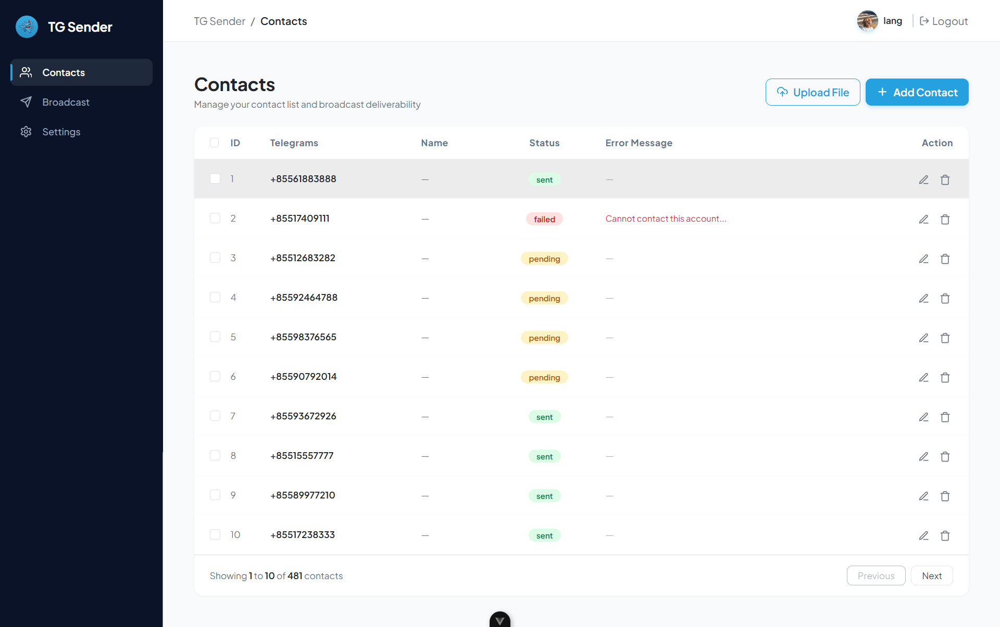

# ⚙️ Telegram Auto Sender — Backend API

Backend RESTful API and automated background worker for the **Telegram Auto Sender** system. Built with **Node.js**, **Express**, **MySQL**, and **GramJS** (Telegram MTProto client).

---

## 📸 System Previews

### 1. Contacts Management


---

### 2. Broadcast & Scheduled Messaging


---

## 🚀 Key Features

- **🤖 Telegram MTProto Integration (GramJS)**: Direct personal account messaging with full MTProto protocol support.
- **📩 Rich Messaging Support**: Send bulk messages with formatted text and compressed image attachments.
- **⏰ Scheduled Broadcasts**: Background cron worker (`node-cron`) automatically executes scheduled message jobs.
- **👥 Contact Normalization**: Automatic phone number formatting (e.g. Cambodian numbers `+855` and international formats).
- **🛡️ Anti-Flood / Safe Delays**:
  - Randomized delays (10–25s) between messages to protect accounts against Telegram spam restrictions.
  - Automatic `FLOOD_WAIT` detection and backoff handler.
- **📁 Bulk Import**: Parse and import contacts from `.xlsx`, `.xls`, `.csv`, and `.txt` files.
- **🖼️ Image Optimization**: Automated image compression using [Sharp](https://sharp.pixelplumbing.com/) and WebP conversion.
- **🔐 Authentication & Security**:
  - JWT-based admin authentication.
  - Password hashing with `bcryptjs`.
  - OTP password reset via email (`nodemailer`).
  - Request validation using `Joi`.

---

## 🛠️ Tech Stack

- **Runtime**: [Node.js](https://nodejs.org/)
- **Framework**: [Express.js](https://expressjs.com/)
- **Database**: [MySQL](https://www.mysql.com/) (using `mysql2`)
- **Telegram Client**: [GramJS (`telegram`)](https://gram.js.org/)
- **Task Scheduling**: [node-cron](https://github.com/node-cron/node-cron)
- **Image Processing**: [Sharp](https://sharp.pixelplumbing.com/) & [Multer](https://github.com/expressjs/multer)
- **Validation**: [Joi](https://joi.dev/)
- **Mailer**: [Nodemailer](https://nodemailer.com/)

---

## ⚙️ Getting Started

### 1. Clone the repository
```bash
git clone https://github.com/songhai-yeanlang/telegram-auto-sender-backend.git
cd telegram-auto-sender-backend
```

### 2. Install dependencies
```bash
npm install
```

### 3. Environment Configuration
Create a `.env` file based on `.env.example`:
```env
PORT=4000

# Database
DB_HOST=127.0.0.1
DB_USER=your_db_user
DB_PASSWORD=your_db_password
DB_NAME=telegram-auto-sender

# Authentication & Mail
JWT_SECRET=your_jwt_secret_key
MAIL_USER=your_email@gmail.com
MAIL_PASS=your_email_app_password

# Telegram MTProto Credentials
API_ID=your_telegram_api_id
API_HASH=your_telegram_api_hash
SESSION_STRING=your_saved_telegram_session_string
```

### 4. Telegram Account Login (One-time Setup)
To generate your `SESSION_STRING` for your Telegram account, run:
```bash
node src/script/loginTelegram.js
```
Follow the interactive prompts to enter your phone number, 2FA password (if enabled), and Telegram OTP. The script will automatically update your `SESSION_STRING` in `.env`.

### 5. Run the Server
```bash
# Development mode
npm run dev

# Production mode
npm start
```

---

## 📄 License
This project is open-source and available under the [MIT License](LICENSE).
